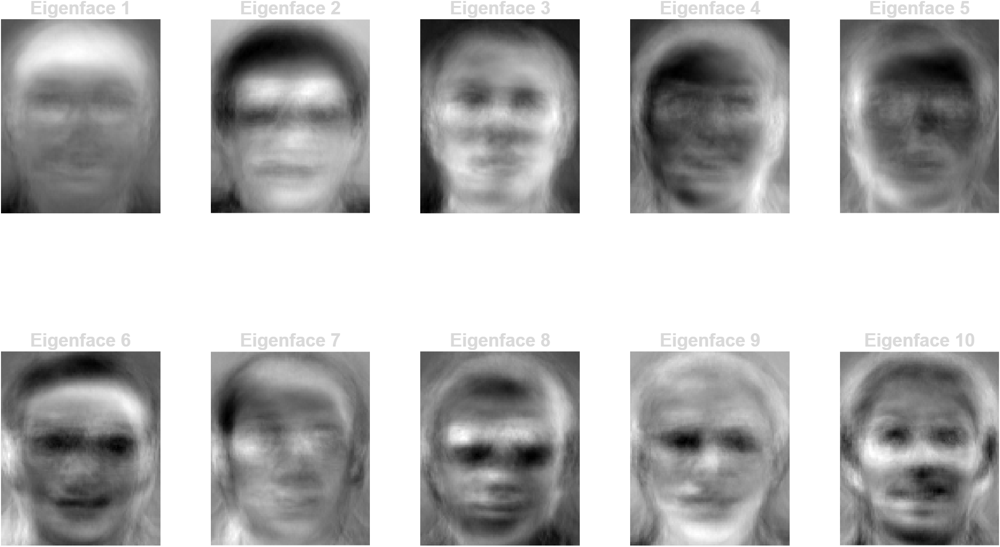
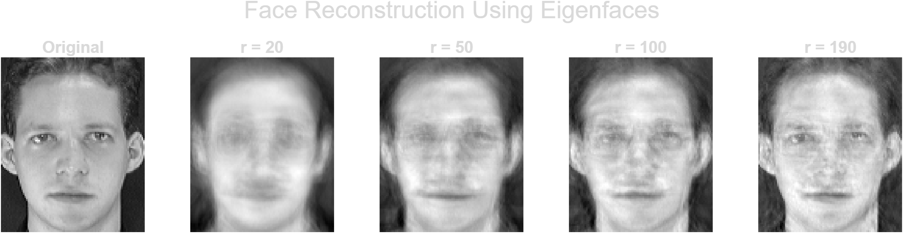
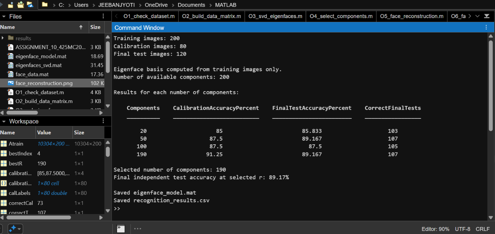
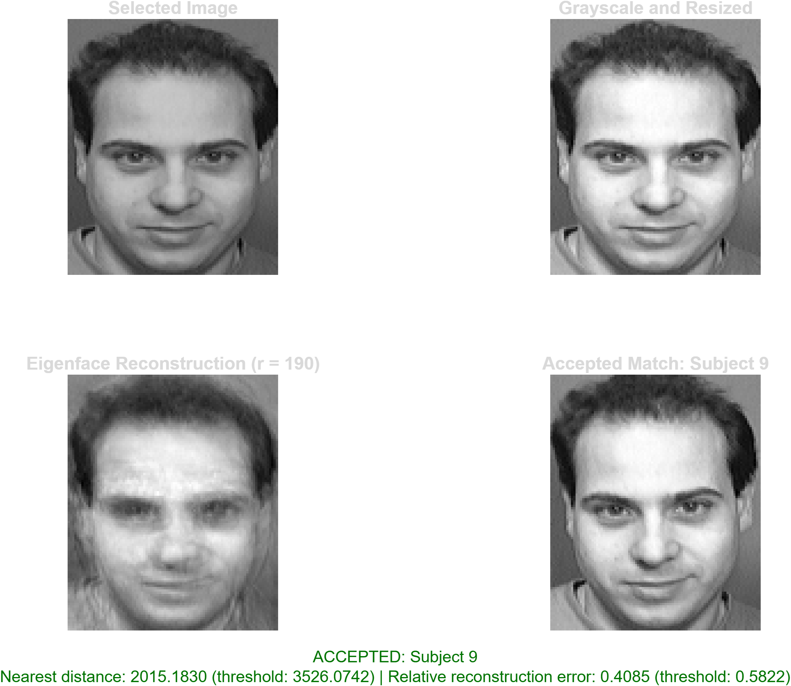
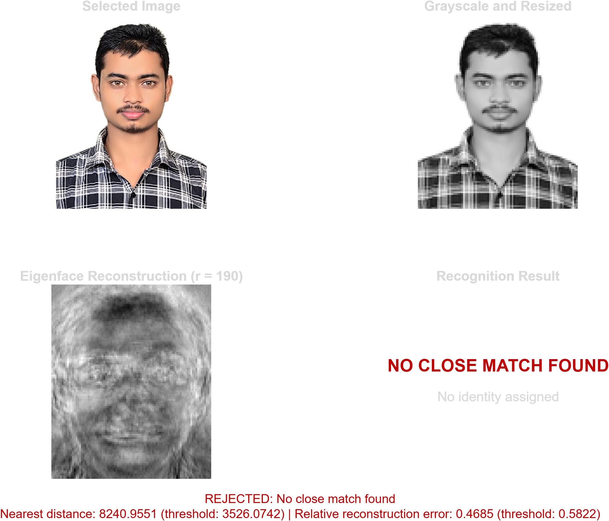

# Eigenfaces for Face Recognition Using Singular Value Decomposition (SVD)

A MATLAB implementation of the Eigenfaces method for face representation, dimensionality reduction, low-rank approximation, and face recognition using Singular Value Decomposition (SVD).

## 1. Project Overview

This project implements an Eigenfaces-based face recognition system using Singular Value Decomposition (SVD) in MATLAB.

The Eigenfaces method represents facial images using a lower-dimensional feature space. Instead of comparing every pixel directly, it extracts the dominant patterns in a collection of training images and represents each face using a set of coefficients.

The project covers the complete workflow, including image loading, data matrix construction, SVD computation, eigenface visualization, dimensionality reduction, face reconstruction, face recognition, and rejection of images that do not sufficiently match the known dataset.

The mathematical background is based on the study of SVD and eigenfaces, together with the face-recognition material covered in the Matrix Computations course at IIT Guwahati.

## 2. Objectives

The main objectives are:

- To understand the mathematical foundations of SVD-based facial representation.
- To construct a data matrix from a collection of grayscale facial images.
- To compute and visualize eigenfaces using SVD.
- To study the effect of retaining different numbers of singular vectors.
- To reconstruct facial images using a reduced-dimensional representation.
- To implement a nearest-neighbour face recognition system.
- To evaluate recognition accuracy using separate training, calibration, and test datasets.
- To implement a basic rejection mechanism for images that do not sufficiently resemble the known faces.

## 3. Mathematical Background

### 3.1 Representing facial images as vectors

Suppose each grayscale facial image has dimensions 112 × 92.

Each image contains 10,304 pixel values. By arranging these pixel values into a single column, each image can be represented as a vector in R^10304.

Let the training dataset contain N images. Arrange the image vectors as columns of a matrix:

P = [p₁, p₂, ..., pₙ]

Here, each column represents one facial image.

For the ORL dataset used in this project, the training set contains 200 images. Therefore, the data matrix has 10,304 rows and 200 columns.

### 3.2 Computing the mean face

The mean face is obtained by averaging the training images pixel by pixel.

μ = (p₁ + p₂ + ... + pₙ) / N

The mean face represents the average facial appearance of the training dataset.

Subtracting the mean face helps focus the analysis on variations between individual faces rather than their common average appearance.

### 3.3 Mean-centred data matrix

Each training image is centred by subtracting the mean face:

aᵢ = pᵢ − μ

The mean-centred data matrix is

A = [a₁, a₂, ..., aₙ]

The columns of A represent the deviations of individual faces from the mean face.

### 3.4 Singular Value Decomposition

The mean-centred data matrix is decomposed using SVD:

A = UΣVᵀ

Here:

- U contains the left singular vectors.
- Σ contains the singular values arranged in non-increasing order.
- V contains the right singular vectors.

The left singular vectors describe important directions of variation in the facial-image space.

In the Eigenfaces method, the leading left singular vectors are used as eigenfaces.

### 3.5 Eigenfaces and dimensionality reduction

Let Uᵣ denote the matrix containing the first r left singular vectors.

Uᵣ = [u₁, u₂, ..., uᵣ]

Each column of Uᵣ represents an eigenface.

Instead of representing a face using all 10,304 pixel coordinates, we can represent it using r coefficients, where r is the number of retained eigenfaces.

For a mean-centred image a, its coefficient vector is

w = Uᵣᵀa

The value of r controls the dimension of the reduced representation.

A smaller r gives a more compact representation but may discard information needed to distinguish between faces. A larger r preserves more information but increases the dimensionality of the representation.

### 3.6 Face reconstruction

The reconstructed mean-centred face is

â = Uᵣw

Equivalently,

â = UᵣUᵣᵀa

To recover the image in its original intensity representation, add the mean face:

p̂ = μ + UᵣUᵣᵀ(p − μ)

This reconstruction approximates the original face using only the retained eigenfaces.

The quality of reconstruction depends on the number of retained components and the information represented by the corresponding singular vectors.

### 3.7 Face recognition

For each training image, compute its coefficient vector in the retained eigenface space.

For a new image, subtract the mean face and project it onto the same eigenface basis.

The new image is then compared with the training images using Euclidean distance between their coefficient vectors.

The nearest training image is the candidate match:

j* = argminⱼ ||w − wⱼ||

The identity associated with the nearest training image is returned as the predicted identity.

This is a nearest-neighbour classifier in the reduced-dimensional feature space. It is not, by itself, a probabilistic classifier.

### 3.8 Rejection of unfamiliar images

A nearest-neighbour classifier always returns a closest training image, even when the input image belongs to someone outside the training dataset.

To address this limitation, the project includes a basic rejection mechanism using two quantities:

- **Coefficient-space distance:** the distance between the input image and its nearest training image in the eigenface space.
- **Reconstruction error:** the difference between the input image and its reconstruction from the retained eigenfaces.

An input is accepted only when both quantities satisfy their respective thresholds. Otherwise, the system reports that no sufficiently close match was found.

The thresholds are calibrated using known-face calibration images. Consequently, this mechanism provides a basic rejection capability rather than a guarantee of reliable recognition of every unfamiliar person.

## 4. Dataset

This project uses the ORL (AT&T) Face Database.

The dataset contains:

- 40 subjects.
- 10 grayscale images per subject.
- 400 images in total.
- Image dimensions of 112 × 92 pixels.
- PGM image files organized into subject folders.

The expected folder structure is:

    DATA set/
    ├── s1/
    │   ├── 1.pgm
    │   ├── 2.pgm
    │   └── ...
    ├── s2/
    ├── ...
    └── s40/

Each subject folder contains ten images.

The dataset must be downloaded separately and placed in a local directory accessible to MATLAB. The absolute path to the dataset should be updated in the relevant script when necessary.

## 5. Experimental Setup

To evaluate the system, the ten images of each subject are divided into three groups.

| Image numbers | Purpose | Total images |
|---|---|---:|
| 1–5 | Training | 200 |
| 6–7 | Calibration | 80 |
| 8–10 | Final testing | 120 |
| **Total** | | **400** |

The eigenface basis is computed using only the training images.

The calibration images are used to select the number of retained components and to calibrate the rejection thresholds.

The final test images are kept separate from the training and calibration sets during model selection.

This separation is important because evaluating a model on images already used to construct the eigenface basis would not provide a fair estimate of recognition performance on unseen images.

## 6. Project Structure

The repository contains seven MATLAB scripts.

### O1_check_dataset.m

Checks the dataset structure and verifies that the expected facial images are available.

### O2_build_data_matrix.m

Loads the grayscale images, converts them into column vectors, computes the mean face, and constructs the mean-centred data matrix.

### O3_svd_eigenfaces.m

Computes the SVD of the mean-centred training matrix and visualizes the leading eigenfaces.

### O4_select_components.m

Studies the retained singular components and helps examine the effect of the number of components on the representation.

### O5_face_reconstruction.m

Reconstructs facial images using selected numbers of eigenfaces and compares the reconstructions with the original images.

### O6_face_recognition.m

Implements the recognition experiment. It constructs the training representation, evaluates candidate component counts using calibration data, and reports final test accuracy.

It also saves the trained model and recognition results for subsequent use.

### O7_interactive_eigenface_demo.m

Provides an interactive demonstration. The user selects an image, and the program preprocesses it, projects it into the eigenface space, reconstructs it, and searches for the nearest training image.

The program applies the calibrated distance and reconstruction-error thresholds to decide whether to accept or reject the candidate match.

## 7. Requirements

The project requires:

- MATLAB.
- The ORL (AT&T) Face Database.
- The seven MATLAB scripts provided in this repository.

No separate machine-learning toolbox is required for the basic SVD and nearest-neighbour calculations implemented in the scripts, provided the MATLAB functions used by the scripts are available in the installed MATLAB version.

## 8. How to Run the Project

### Step 1: Download the repository

Clone or download this repository from GitHub.

### Step 2: Prepare the dataset

Download the ORL face dataset and place the subject folders in a local directory.

Check that the dataset contains the expected folders and image files.

### Step 3: Configure the dataset path

Open the relevant MATLAB script and update the dataset path to match the directory on your computer.

### Step 4: Inspect the dataset

Run:

    O1_check_dataset.m

Confirm that the expected images can be found.

### Step 5: Construct the data matrix

Run:

    O2_build_data_matrix.m

This step loads the images and constructs the mean-centred training data matrix.

### Step 6: Compute and visualize eigenfaces

Run:

    O3_svd_eigenfaces.m

Inspect the leading eigenfaces obtained from the SVD.

### Step 7: Examine component selection

Run:

    O4_select_components.m

Study the effect of retaining different numbers of components.

### Step 8: Reconstruct facial images

Run:

    O5_face_reconstruction.m

Compare the original images with their reconstructions using different component counts.

### Step 9: Evaluate face recognition

Run:

    O6_face_recognition.m

The script evaluates the selected component counts, reports calibration and final test performance, and saves the trained model and results.

### Step 10: Run the interactive demonstration

Run:

    O7_interactive_eigenface_demo.m

Select an image when prompted. The program displays the selected image, its preprocessed representation, its eigenface reconstruction, and the nearest training image or a rejection result.

Run the scripts from the MATLAB environment with the required dataset paths configured correctly.

## 9. Experimental Results

The following results were obtained using the described training, calibration, and final test split.

| Number of components | Calibration accuracy | Final test accuracy | Correct final predictions |
|---:|---:|---:|---:|
| 20 | 85.00% | 85.83% | 103/120 |
| 50 | 87.50% | 89.17% | 107/120 |
| 100 | 87.50% | 87.50% | 105/120 |
| 190 | 91.25% | 89.17% | 107/120 |

The component count was selected using calibration accuracy. Among the tested values, 190 components achieved the highest calibration accuracy of 91.25%.

The corresponding final test accuracy was 89.17%, with 107 correct predictions out of 120 test images.

However, 50 components also achieved 89.17% final test accuracy. Thus, the final test results do not establish that 190 components are superior to 50 components in recognition accuracy.

The results illustrate that retaining more singular components does not necessarily improve final test accuracy. The choice of component count depends on the trade-off between representation size, retained information, and generalization to unseen images.

These results apply to this dataset, split, and implementation. They should not be interpreted as a guarantee of performance on images captured under different conditions or on arbitrary individuals.

## 10. Interactive Demonstration and Initial Checks

The interactive demonstration was checked using three types of inputs:

1. An image of a known subject that was not used for training was accepted.
2. Another image of a known subject from the calibration portion was accepted.
3. A photograph outside the ORL dataset was rejected by the system.

These are initial functional checks showing that the recognition and rejection paths execute as intended. They are not a comprehensive evaluation of unknown-person rejection performance.

A more complete evaluation would require a separate set of images from individuals who do not appear in the ORL training dataset, together with appropriate measurements of false acceptance and false rejection rates.

## Key Findings

- SVD provides a mathematical framework for decomposing the mean-centred facial data matrix into singular vectors and singular values.
- Retaining the leading singular components produces a low-rank approximation of the facial data, enabling dimensionality reduction and image reconstruction.
- Increasing the number of retained components generally preserves more reconstruction detail, but does not guarantee higher face-recognition accuracy.
- In the evaluated experiment, 50 and 190 components both achieved 89.17% final test accuracy.
- Selecting the number of components using calibration data helps separate model selection from final evaluation.
- The rejection mechanism demonstrates a basic approach to handling unfamiliar inputs, but requires further evaluation on an independent unknown-person dataset.

## 11. Limitations

The current implementation has several limitations:

- The experiment uses a relatively small, fixed dataset.
- The images are grayscale and have a fixed resolution.
- The nearest-neighbour classifier depends on the quality of the training representation and the selected distance measure.
- Recognition performance can be affected by lighting, facial expression, pose, and image alignment.
- The rejection thresholds are calibrated using known-face images and may not generalize well to unfamiliar individuals.
- The system is intended as an educational implementation of SVD-based face recognition, not as a production-grade biometric security system.
- The reported accuracy depends on the selected dataset split and the tested component counts.

Future improvements could include a more extensive evaluation on independent unknown-person images, systematic threshold selection, comparison with alternative classifiers, and experiments on the sensitivity of recognition to image conditions.

## 12. References

1. Muller, N., Magaia, L., and Herbst, B. M. (2004). *Singular Value Decomposition, Eigenfaces, and 3D Reconstructions*. SIAM Review, 46(3), 518–545.

2. Alam, R. *MA580H: Matrix Computations — Lecture 16: Applications of Singular Value Decomposition*. IIT Guwahati, January–May 2025. Section: Face Recognition. Course lecture material provided for this project.

3. ORL (AT&T) Face Database. The facial-image dataset used for the experiments in this project.

## 13. Author

**Jeebanjyoti Das**

M.Sc. Computational Mathematics and Data Science  
National Institute of Technology Rourkela

GitHub repository: https://github.com/jjdas3141/iit-Guwahati-summer-internship

---

This project was developed to study the mathematical foundations of SVD and explore their practical application to facial-image representation, reconstruction, and recognition using MATLAB.

## Visual Results

### Eigenfaces

### Face Reconstruction

### Recognition Accuracy

### Known-Face Recognition

### Unknown-Face Rejection

